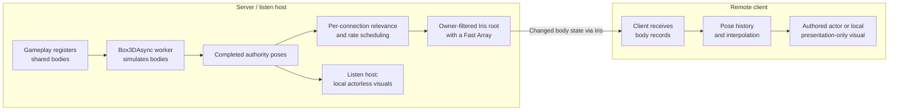

# Box3D Replication

`Box3DReplication` presents shared **dynamic** Box3DAsync bodies over Unreal's Iris replication system. The server owns the physics simulation; clients receive poses and render nonreplicated presentation actors. The module does not replicate a native Box3D world or run the shared physics simulation on clients.

This is an integration starting point, not a guarantee of production readiness. The example project was configured and smoke-tested with UE 5.7.4. Test your own engine version, network conditions, body counts, and gameplay lifecycle.

## Setup

1. Enable the `Box3DUnreal` and `Iris` plugins in your project. Ensure the Async backend is enabled under **Project Settings → Plugins → Box3D**. The plugin descriptor loads `Box3DReplication` as a Runtime module.
2. In a C++ module that uses this API, add `Box3DReplication` to `PublicDependencyModuleNames` when its public headers expose replication types, or to `PrivateDependencyModuleNames` otherwise. Add `Box3DAsync` as needed for directly used async physics APIs. `Box3DReplication` configures its own Iris build support and registers its Iris object factory; games should not register that factory again.
3. Enable Iris for the game net driver. The example project uses these settings in `Config/DefaultEngine.ini`:

   ```ini
   [SystemSettings]
   net.SubObjects.DefaultUseSubObjectReplicationList=1
   net.Iris.UseIrisReplication=1
   ```

   Enable the Iris plugin in the `.uproject`, and use an Iris-capable game net driver on both server and clients. `-UseIrisReplication=1` can be used for the example's command-line smoke runs. Configuration can vary by engine version and project; verify that the active net driver actually has an Iris replication system.

   The example also includes this **optional delta-compression eligibility** configuration. Its effect depends on the Iris configuration and runtime compression policy; it is not a substitute for enabling Iris:

   ```ini
   [/Script/IrisCore.ObjectReplicationBridgeConfig]
   +DeltaCompressionConfigs=(ClassName=/Script/Box3DReplication.Box3DIrisReplicationRoot)
   ```

4. For placed props, put an `ABox3DAsyncDirector` in the world and use `ABox3DAsyncPresentationActor` instances with a static mesh that has authored simple collision. Set **Collision Mode** to `AuthoredDynamicCollision` and **Replication Policy** to `Shared`. Each shared prop needs a valid, unique `ReplicationKey` that matches its corresponding placed actor on server and clients. Check keys after duplicating props. `LocalOnly` props are not sent through Iris.
5. Tune **Project Settings → Plugins → Box3D Replication → Distance Tiers**. Keys are maximum distances in centimeters; values are desired update rates in Hz. The defaults are 1,500/60, 2,500/45, 4,000/30, 7,000/15, and 10,000/5. The largest distance is the relevance cutoff. Tier and cull hysteresis are separate settings. Actual delivery depends on changes, scheduling budgets, the net driver, and network conditions.

## Registering actorless bodies

On the authority game thread, create the body through `UBox3DAsyncSubsystem` and wait for its **successful creation result**. Give the body a unique stable key and register the qualified handle, mesh asset path, and visual scale with `UBox3DIrisReplicationSubsystem::RegisterActorlessSharedBody`. The current registration accepts dynamic shared bodies only. Keep the key and handle with your authoritative body; registration returns `void`, so check input and logs for rejection, including duplicate keys.

```cpp
// Authority, after Result.bSucceeded from TryTakeCreationResult:
const FGuid BodyKey = FGuid::NewGuid(); // Store this key with the body.
Replication->RegisterActorlessSharedBody(
    Result.BodyHandle, BodyKey, VisualMeshPath, VisualScale, true);

// When despawning, unregister before requesting native-body removal:
Replication->UnregisterSharedBody(BodyKey, Result.BodyHandle.Id);
Physics->TryRemoveBody(Result.BodyHandle); // Retry if the command queue is full.
```

Supply valid `Replication` and `Physics` subsystem pointers and a valid `FSoftObjectPath` for a `UStaticMesh`. Make sure the asset is available in packaged client builds; this module resolves it asynchronously and does not itself guarantee cooking. The caller retains ownership of the native body and must handle creation and removal failures. If gameplay teleports a registered body or otherwise causes a discontinuity, call `NotifyBodyDiscontinuity` with its key and body ID so remote playback can reset its history.

For authored presentation actors the director handles registration after successful body creation and unregisters on removal. The actor's local mesh is presentation only: its component does not simulate or collide in Chaos. Existing map actors and actorless visuals use different binding paths, so ensure placed shared actors have the same identity on each peer.

## How the replication path works



The listen-host branch applies to actorless visuals; authored props retain their director-driven local presentation. A dedicated server does not use that visual branch.

1. The authority registers shared bodies. The replication subsystem matches their qualified handles to completed Box3DAsync worker frames and keeps the latest pose and capture information.
2. For each connected parent connection, the server creates an owner-filtered Iris root object. It selects relevant bodies using that connection's view, distance tiers, hysteresis, and scheduling limits. Each root owns a Fast Array of body records; this is not an Iris object or replicated actor per physics body.
3. Iris tracks and serializes changed root state and delivers it to the owning connection. A body record identifies the body and carries presentation metadata, quantized position, rotation, timing, and lifecycle revisions. Iris handles transport of this replicated object state; the module decides relevance, staging, and how the received poses are presented.
4. A remote client binds an authored actor by key or loads the requested mesh and spawns a local presentation-only actor. It buffers received poses and interpolates them for display. A listen host instead drives actorless visuals directly from its authority poses; it does not create a loopback connection or another root. A dedicated server creates no actorless presentation visuals.
5. Unregistering a body removes it from connection state and retires its local host visual. Connection loss and world teardown retire associated roots and visuals.

Iris replication is server-to-client state delivery, not a gameplay command protocol. A client that wants to push or spawn a shared body needs a game-owned, server-validated request path. Replicated poses do not automatically deliver damage, collision events, joint breaks, or other gameplay events.

## Current boundaries

- Shared kinematic bodies and ragdoll groups are not yet supported by this Iris presentation path. Async physics APIs for them do not imply network replication.
- The authority worker frame uses a fixed world origin. If the authority world origin shifts, replication is suspended and roots are retired until the world is reloaded.
- An actorless mesh must be loadable before its visual can appear. Visuals have no Chaos collision or movement replication; the server's Box3D bodies remain authoritative.
- The example's listen-host check passed for 32 actorless visuals, with a near client receiving Iris state. This does not establish behavior under packet loss, travel, many clients, or production load.

Public entry points: [replication subsystem](Public/Box3DIrisReplicationSubsystem.h), [presentation actor](Public/Box3DAsyncPresentationActor.h), [director](Public/Box3DAsyncDirector.h), and [replication settings](Public/Box3DReplicationSettings.h).
